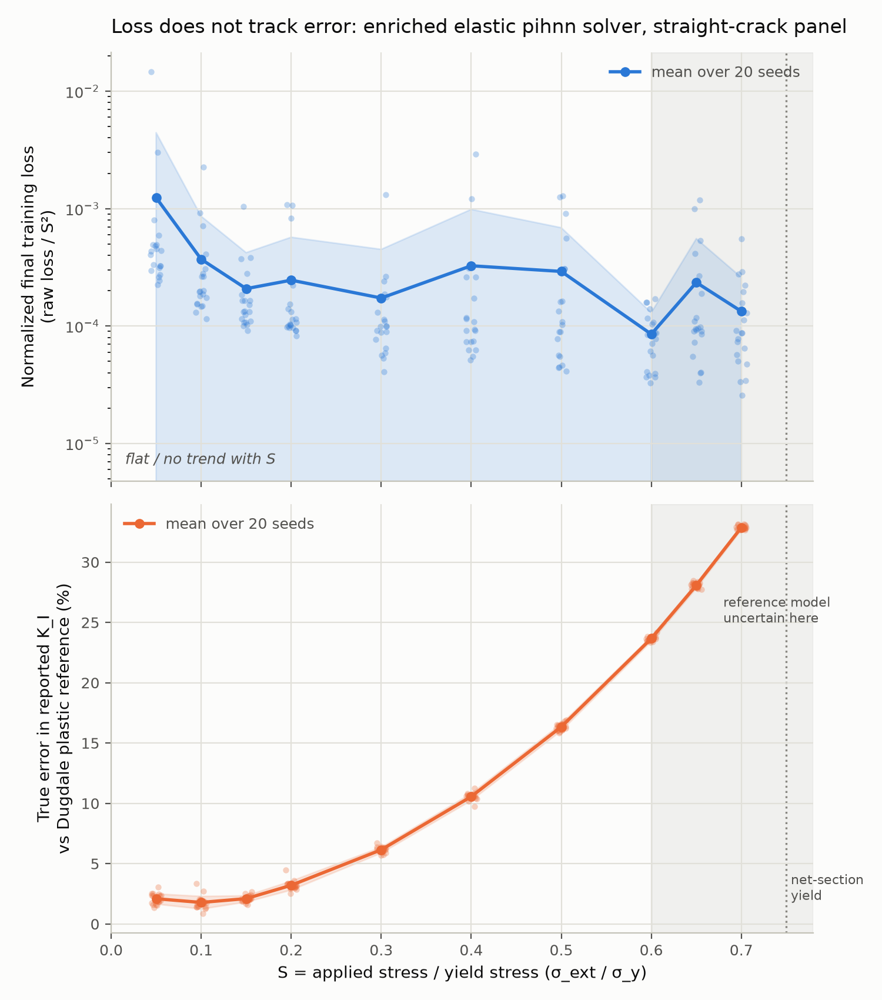

# Does the training loss of an enriched elastic crack solver signal when LEFM stops being valid?

**Short answer: no.** Across a ten-point sweep of applied-load-over-yield-stress,
the true error in the reported stress intensity factor grows by a factor of ~37
(0.9% -> 33%), while the solver's own training loss shows no corresponding trend
-- it is flat to within seed noise, and if anything trends slightly *down* over
the same range. A practitioner watching only the loss curve would see nothing
unusual as the reported K_I became increasingly wrong. This is the silent-failure
mode the study set out to check for, and it is real: the gate condition for the
proposed matched-asymptotic follow-on study is satisfied.

## Setup

**Solver under test:** [pihnn](https://github.com/teocala/pihnn) v1.1
(LGPL-2.1), the Williams-enriched holomorphic PINN from its own
`examples/cracks/straight_crack_williams.py` benchmark -- a finite
center-cracked panel (half-length `l=4`, half-height `h=6`, crack half-length
`a=1`) under remote tension `sig_ext`, elastic-only, plane strain. We wrapped
this example (`src/pihnn_wrapper.py`) without modifying the installed package;
the only change from the published example is that `sig_ext` is swept.
We first reproduced the published benchmark exactly (K_I = 1.841 vs the
paper's analytical 1.852, 0.59% error at 1000 epochs, S=1) before running
anything new, to confirm the wrapper is faithful.

**Sweep parameter:** `S = sig_ext / sigma_y`, with `sigma_y` fixed at 1.0, so
`S` is numerically identical to `sig_ext`. `S` ranges from 0.05 (deeply
elastic) to 0.70 (approaching net-section general yield, which for this
geometry occurs exactly at `S = sigma_y * (W-2a)/W = 0.75`). 10 sweep points:
0.05, 0.10, 0.15, 0.20, 0.30, 0.40, 0.50, 0.60, 0.65, 0.70.

**Seeds:** 20 independent random seeds per sweep point (200 training runs
total), each a fresh network initialization and fresh boundary-point sampling.
All 20 are reported; nothing is cherry-picked. Prior work on this codebase
found seed variance large enough to swamp single-run conclusions, and we
reproduce that here at the low-S end (see below).

**Training:** 2000 epochs, Adam, lr=1e-2, `units=[1,10,10,10,1]`, chosen by
calibration (`configs/sweep_config.json` records the calibration numbers):
at S=0.05 -- the worst case, because the loss floor from finite training-point
sampling is an *absolute* quantity while the target signal shrinks with S --
LEFM-verification error was 2.45% at 1000 epochs, 1.20% at 2000, 1.15% at
4000. 2000 epochs is the point past which more training stops mattering.
CPU only. Full sweep: 200 runs x ~18s/run ~= 66 minutes wall clock.

## The reference problem: what "true" K_I means once plasticity matters

We need an independent ground truth for K_I (or J) at each S that accounts for
the plastic zone -- pihnn cannot supply this itself, since it has no plasticity
model.

**What we tried and rejected:** the GE/EPRI (Kumar-German-Shih 1981) J-estimation
handbook, which is the standard engineering reference for this kind of problem,
requires tabulated `h1(a/W, n)` coefficients. We searched for a citable source
of these tables and could not find the actual numeric values (only descriptions
of the method) -- see the two `WebSearch` queries in this session. Reproducing
specific multi-digit tabulated engineering constants from model memory would
produce a reference that *looks* authoritative but cannot be verified, which is
exactly the "ground truth" substitution the task instructions rule out. We did
not use it.

We also considered building a small elastic-plastic FEM reference from scratch
(J2 plasticity, return mapping, domain-integral J extraction). We judged this
too much new, unverified numerical code to trust within this project's time
budget -- a subtly wrong from-scratch FEM would be a *worse* failure mode than
an honestly-scoped analytical reference, because it would look like ground
truth without being independently checkable by a reader in reasonable time.

**What we used instead:** two independent closed-form models that need no
tabulated data and can be checked by hand from their equations
(`src/reference.py`):

1. **Dugdale (1960) strip-yield model** (primary reference). Gives a secant
   plasticity-correction factor `sqrt(sec(pi*S/2))` applied to the exact
   finite-geometry elastic K_I(S) = S * 1.852. Stays well-defined and diverges
   correctly as S approaches net-section yield.
2. **Irwin (1960) first-order plane-strain plastic-zone correction**
   (cross-check, valid only for small-scale yielding). Used to sanity-check
   the Dugdale reference at small S and to quantify where the reference
   itself becomes uncertain.

**Stated limitations (not buried):**
- Dugdale's model is derived for an infinite plate in **plane stress**;
  pihnn's formulation is **plane strain** (confirmed from the `(1-nu^2)/E`
  factor in `pihnn.utils.compute_J_integral`). Applying the Dugdale factor to
  a plane-strain elastic K is a standard engineering approximation, not a
  matched plane-strain elastic-plastic solution.
- Neither reference model includes strain hardening (both assume
  elastic-perfectly-plastic).
- Both are known to lose accuracy as the net-section stress approaches yield.
  The two models agree to within 0.1% at S=0.05 and diverge from each other
  to ~30% by S=0.70 (`reference_disagreement` column in the results). We treat
  S >= 0.6 as a "reference uncertain" zone (shaded gray in the figure) --
  the absolute error numbers there carry real uncertainty from the reference
  choice itself, though both models still agree on the direction (monotonic,
  accelerating growth).

If a stronger reference is wanted later (a real elastic-plastic FEM run, or
verified EPRI table values from someone with the physical handbook), it would
sharpen the magnitude at high S. It would not change the qualitative finding,
because that finding is already visible well inside the region (S <= 0.5)
where both reference models agree closely.

## Separating "undertrained" from "assumption invalid"

This is the confound the task flagged as having caused a wrong conclusion in
prior work on this project. We control for it directly: pihnn is solving an
exact linear-elastic boundary value problem with a **known closed-form
solution**, `K_el(S) = S * 1.852`, independent of whether that BVP is the
physically correct model at that load level. We compute
`lefm_verification_error = |K_I_reported - K_el(S)| / K_el(S)` at every run.
This measures training quality only -- it cannot be affected by plasticity,
because plasticity never enters pihnn's problem.

Result: `lefm_verification_error` stays below 3% at every single one of the
200 runs (worst case: S=0.05, max 2.93% over 20 seeds; mean 1.9% at S=0.05,
falling to 0.4% by S=0.70). It does not grow with S -- if anything it shrinks,
because the absolute BC magnitude (and hence the target signal) grows with S
while the training noise floor stays roughly fixed. This rules out
undertraining as the explanation for what follows: the solver is converging
about equally well (in fact slightly better in relative terms) at every point
in the sweep.

## Result

| S | plastic-ref. error, mean (range over 20 seeds) | normalized loss, mean (range over 20 seeds) | LEFM-verification error, mean |
|---|---|---|---|
| 0.05 | 2.1% (1.4%-3.1%) | 1.2e-3 (2.3e-4 - 1.5e-2) | 1.9% |
| 0.10 | 1.8% (0.9%-3.3%) | 3.7e-4 (1.2e-4 - 2.3e-3) | 1.2% |
| 0.15 | 2.1% (1.6%-2.7%) | 2.1e-4 (9.2e-5 - 1.0e-3) | 0.7% |
| 0.20 | 3.2% (2.5%-4.5%) | 2.5e-4 (8.3e-5 - 1.1e-3) | 0.8% |
| 0.30 | 6.2% (5.7%-6.7%) | 1.7e-4 (4.1e-5 - 1.3e-3) | 0.6% |
| 0.40 | 10.6% (9.7%-11.3%) | 3.3e-4 (5.1e-5 - 2.9e-3) | 0.6% |
| 0.50 | 16.3% (15.9%-16.9%) | 2.9e-4 (4.1e-5 - 1.3e-3) | 0.5% |
| 0.60 | 23.7% (23.4%-24.2%) | 8.5e-5 (3.3e-5 - 1.7e-4) | 0.4% |
| 0.65 | 28.1% (27.8%-28.5%) | 2.4e-4 (3.3e-5 - 1.2e-3) | 0.5% |
| 0.70 | 32.9% (32.7%-33.2%) | 1.3e-4 (2.6e-5 - 5.5e-4) | 0.4% |

Note the plastic-reference error's seed-to-seed range *tightens* as S grows
(e.g. +/-40% relative spread at S=0.05, +/-1% relative spread at S=0.70) while
loss's range stays wide (roughly 2 orders of magnitude) at every S. The two
quantities are not just uncorrelated in trend; their spread behaves oppositely
across the sweep, too.

(Full per-run data: `results/processed/all_runs.csv`. Per-S aggregates:
`results/processed/summary_by_S.csv`. Raw per-run loss trajectories and model
weights: `results/raw/S{value}_seed{seed}/`.)

**Correlation diagnostics** (`results/processed/correlation_stats.txt`,
computed by `src/analyze.py`):

- All 200 runs, normalized loss vs plastic-reference error: Pearson r = -0.117
  (p=0.098, not significant), Spearman rho = -0.412 (**p=1.3e-9, significantly
  negative**).
- Per-S means (n=10 sweep points): Spearman rho = -0.636 (p=0.048).
- Within-S only (n=20 seeds per point, controlling for S -- i.e. does ordinary
  training-noise variation predict error at *fixed* load?): mean r = +0.257,
  inconsistent in sign and mostly not significant point-by-point. This is the
  one place loss and error move together at all, and it is a small,
  seed-noise-scale effect, unrelated to the S-driven trend.

## Interpretation

The loss does not track the error. At the aggregate and per-sweep-point level
the correlation is **negative** -- loss trends slightly down over the same
range where error grows 37x. The only positive relationship is a weak,
noisy, seed-level one that has nothing to do with the load ratio.

This is not a surprising empirical fact discovered after the run; it follows
from how the solver is built, and the run confirms it holds in practice.
pihnn's loss is the residual of a linear-elastic PDE and boundary conditions.
`sigma_y` and everything about plasticity never appear anywhere in that
residual. There is no mechanism by which the loss *could* respond to the
plastic zone size -- the network is not merely failing to notice invalidity,
it is structurally unable to represent the question. Confirming this
empirically, with seed spread and an undertraining control, rules out the
alternative explanation that the flat loss was actually a training artifact
masking a real (but undetected) sensitivity.

**Reading the task's own decision rule** ("If the loss rises as the error
rises, the solver signals its own invalidity... If the error grows while the
loss stays flat, that is the failure mode"): this run lands in the failure
mode. The concern that motivated this whole study -- an enriched elastic
solver converging confidently to a wrong `K_I` once plasticity becomes
non-negligible, without its own diagnostics showing anything -- is real for
this solver and this problem.

## What this means for the follow-on study

The task states plainly that if there is no silent failure to detect, the
proposed matched-asymptotic (elastic + HRR, with an explicit matching
condition) detector study should not proceed. We found a silent failure:
**the gate condition is satisfied, and the follow-on study is justified.**
Concretely, a matched-asymptotic formulation would need to explain a signal
that grows by 37x while the current network's only self-reported diagnostic
is flat -- that is the gap such a method would need to close.

## Caveats on this result

- The reference's absolute magnitude is less certain for S >= 0.6 (see
  "reference uncertain" shading in the figure); the qualitative finding does
  not depend on that region, since the trend is already clearly monotonic and
  loss-uncorrelated by S=0.3-0.5, well inside the region both reference models
  agree on.
- This is one geometry (finite center-cracked panel), one solver
  (pihnn's Williams enrichment), one crack-tip mode (pure mode I, no mixed
  mode), and one hardening assumption (none, in the reference model). We do
  not claim this generalizes to every enriched PINN crack solver or every
  geometry without further testing.
- We did not build a full elastic-plastic FEM reference; see the "reference
  problem" section above for why, and what it would take to get a tighter
  bound at high S.
