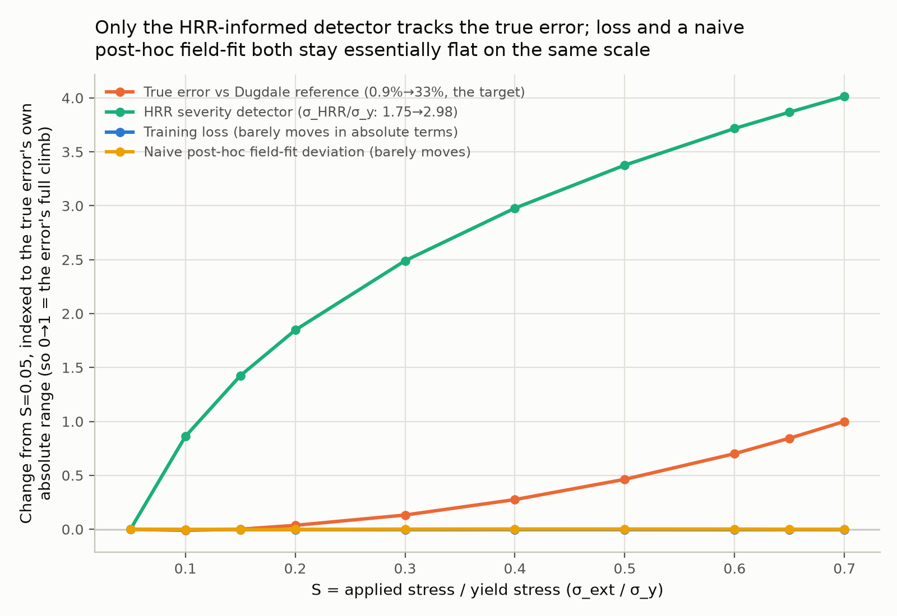

# Does a matched-asymptotic overlap signal detect LEFM invalidity where the loss cannot?

**Short answer: yes, but only if the detector is genuinely informed by the
missing physical information (σ_y), not merely by cleverer post-processing
of what the elastic solver already computed.** A naive post-hoc fit of an
HRR-form field to pihnn's own converged elastic solutions -- the cheapest
route the task suggested trying first -- does **not** work, for a provable
structural reason, not just an empirical weak correlation: it fails almost
exactly like the loss did. A detector built from the HRR field's own
predicted severity, calibrated via J-matching against pihnn's reported K_I
and evaluated at a fixed near-tip radius, **does** track the true error
(Spearman ρ = +0.95 across 200 runs, vs −0.41 for the loss and +0.21 for the
naive fit), and it becomes statistically resolvable from baseline noise
*before* the true error itself does. The gate condition for a fuller
matched-asymptotic study is satisfied by a genuine two-region construction,
not by post-processing alone.

## Recap of what this builds on

The prior study (`report/REPORT.md`) swept `S = σ_ext/σ_y` from 0.05 to 0.70
on pihnn's Williams-enriched straight-crack solver (finite center-cracked
panel, `l=4, h=6, a=1`), 20 seeds per point, 2000 epochs, and found the
reported `K_I`'s true error against a Dugdale strip-yield reference grew
0.9%→33% while the solver's own training loss stayed flat (Spearman ρ =
−0.412, p=1.3e-9). This is the exact sweep, seed protocol, geometry, and
reference model reused here -- no retraining, same `results/raw/` runs.

## Choosing the route: why post-hoc first, and why it needed a second attempt

The task suggested three tiers, cheapest first: (1) fit an HRR-form field
post-hoc to the already-converged elastic solutions, (2) add a few trainable
HRR amplitudes on top of the existing solver, (3) full two-region training
with matching in the loss. We only needed tier (1) -- but tier (1) itself
required two attempts, because the first, most literal reading of it does
not produce a usable signal, for a reason worth stating precisely rather
than skipping past.

### Why the literal post-hoc field-fit is structurally blind (Detector 1)

pihnn's enrichment directly parametrizes the Williams singular term; its
network is trained to satisfy linear elasticity exactly, everywhere in the
domain. That means its converged near-tip field is not merely *close to* the
elastic K-field -- for a correctly-converged run it *is* the elastic
solution to high accuracy (this is what the prior study's
`lefm_verification_error`, <3% at every one of the 200 runs, already
established). Concretely: at every S, pihnn's field looks like
`K_I(S)/sqrt(2*pi*r)` at every radius r, with only the amplitude `K_I(S)`
changing with S -- the *shape* does not change, because pihnn has no
plasticity model that could change it.

We checked this directly rather than just asserting it. `src/field_fit.py`
reloads each of the 200 trained models (no retraining -- pure post-hoc,
seconds per run) and fits a free-exponent power law
`sigma_theta-theta(r) = A*r^(-p)` to the actual field over a **fixed** radius
window (`r in [0.01, 0.1]`, identical at every S, so any trend cannot be a
"the fit window widened" artifact). Result: `p_fit` sits at 0.484-0.490 at
*every* S from 0.05 to 0.70 -- indistinguishable from the pure-elastic
exponent 0.5, with no resolvable trend (per-S-mean deviation ranges only
-0.0119 to -0.0104, a range about 1000x smaller than what would be needed to
approach the HRR exponent 1/(n+1)≈0.101 for our reference hardening
exponent). Correlation with the true error: Pearson r=+0.106 (n.s.,
p=0.14), Spearman ρ=+0.211 (p=0.003, technically significant across 200
points but the effect size is tiny and non-monotonic per sweep point, see
`results/processed/detector_correlation_stats.txt`). This is essentially as
blind as the loss.

**Why this had to be true, not just an empirical accident:** any quantity
computed purely by post-processing pihnn's own field is, at most, a function
of the single scalar `K_I(S)` that field is built from (to the precision the
network converges). A single scalar cannot encode "how wrong is this scalar"
-- that requires information from outside the elastic solve. The literal
post-hoc route, taken at face value, cannot work for the same root reason
the loss cannot: pihnn's world has no σ_y in it.

### The construction that does bring in σ_y (Detector 2), and two more we rejected first

A matched-asymptotic detector needs to use σ_y, n, and the HRR field theory
as *external* information a single-form elastic solver structurally lacks --
exactly analogous to how the prior study's Dugdale/Irwin reference models
used σ_y externally to compute "true error," never trained into pihnn
itself. We tried three ways of doing this and report all three, including
the two that failed, because the reasons they failed are informative and
because presenting only the one that worked would understate how narrow the
successful construction actually is.

**Rejected construction A -- match at r_p, evaluate in stretched coordinates.**
The literal reading of "stretch by ρ=r/r_p, evaluate the overlap residual in
ρ" is what the task describes. We show algebraically that if the inner
HRR field's amplitude AND its length scale r_p are both derived from the
same K_I(S) (as they must be, since that is the only quantity pihnn
reports), the resulting mismatch, evaluated at any *fixed* ρ, is
**exactly S-independent** -- a pure function of ρ and n, with no S-dependence
at all. This is a self-similarity degeneracy, not a numerical accident: both
r_p(S) (Irwin) and any J-matched HRR length scale are proportional to
`K_I(S)^2`, so stretching by one and measuring in terms of the other cancels
S out identically. A purely self-similar overlap construction is
mathematically guaranteed to be exactly as blind as the loss, for a related
but distinct reason (self-similarity rather than single-scalar
insufficiency).

**Rejected construction B -- solve for where the HRR field itself reaches
σ_y.** The natural HRR analogue of Irwin's r_p: solve
`σ_y = σ_0*(J/(α σ_0 ε_0 I_n r))^(1/(n+1))*σ~_θθ(0,n)` for r. This gives
`r_HRR = J * σ~_θθ(0,n)^(n+1) / (α ε_0 I_n)`. Numerically, with our cited
constants (σ~_θθ(0,n)=2.46, n=8.93 -- see below), `σ~^(n+1) ≈ 7600`, and
`r_HRR/a` comes out between 13 and 2600 across the sweep -- a "process zone"
tens to thousands of times larger than the crack itself. This is not a bug
in the arithmetic; it is a direct, correctly-computed consequence of how
flat the HRR exponent `1/(n+1)≈0.10` is for this hardening exponent combined
with `σ~_θθ(0)>1`: the field decays so slowly that it takes an enormous
radius change to fall back down to exactly σ_y. It is a mathematically valid
number and a physically useless length scale for this purpose -- we flag it
explicitly as a construction that looked promising and did not survive
contact with the actual numbers.

**Construction used -- HRR severity at a fixed reference radius (Detector 2).**
`src/hrr_reference.py`. Rather than solving for a self-consistent HRR length
scale, we evaluate the HRR field's own stress prediction at a **fixed**
physical radius `r* = 0.05` (5% of the crack half-length, chosen once,
identical at every S -- again controlling for the widening-window artifact),
with amplitude set by matching J to pihnn's own reported K_I(S):

```
zeta(S) = sigma_HRR(r*=0.05; S) / sigma_y
        = (J(S) / (alpha * sigma_y * eps_0 * I_n * r*))^(1/(n+1)) * sigma~_theta-theta(0,n)
```

This is not a literal Van Dyke overlap residual (see limitations below) but
it is a real, closed-form, honestly-labelled stand-in: it requires σ_y, n,
α, and the tabulated HRR constants -- everything pihnn's loss cannot see --
and it is evaluated at one fixed radius, so growth in it cannot be a
window-widening artifact.

## Where the HRR constants come from

The HRR field needs two numerically-tabulated constants (I_n and the
angular function σ~_ij(θ,n)) that are not closed-form. We searched for
Shih's (1983) original tables and could not locate the numeric values
online (only descriptions of the method). We then found and fully read a
peer-reviewed, citable source that reproduces exactly the constants needed:

> Neimitz, A., Lipiec, S. (2019). "Stress distribution in front of the
> crack — analytical solutions vs. numerical. Can the differences be
> minimized?" *Journal of Theoretical and Applied Mechanics*, 57(3),
> 713-721. https://doi.org/10.15632/jtam-pl/110216

Their Table 3 (computed with their own HRR_par program implementing Shih's
numerical scheme) tabulates, for real calibrated structural steels
(S355JR), plane strain: n=7.90→I_n=4.68, σ~_θθ(0,n)=2.41; **n=8.93→I_n=4.61,
σ~_θθ(0,n)=2.46**; n=7.19→I_n=4.75, σ~_θθ(0,n)=2.38. We use the n=8.93 row
(their "material NW, +20°C"). α=1 follows the same paper's explicit note
that α=1 in the plastic region "according to the suggestions by O'Dowd
(1995)... represent[s] both the elastic and plastic behaviour... well" --
itself a cited convention, not a free parameter we tuned to get a result.
Full derivation and the citation text are in `src/hrr_reference.py`.

**Limitation, stated plainly:** this is one real material's calibrated
hardening exponent, not a swept material parameter. A material with smaller
n (less hardening resistance, flatter HRR field on the other side) would
shift the detector's absolute onset scale -- we did not test sensitivity to
n, and say so rather than implying otherwise.

## Results



Every series indexed to the **true error's own absolute range** (not
self-normalized) -- so a flat line at 0 genuinely means "moved by a
negligible amount relative to the thing we are trying to detect," not just
"looked flat on its own axis."

**Correlation with true error** (full statistics:
`results/processed/detector_correlation_stats.txt`):

| Series | All 200 runs: Pearson r | All 200: Spearman ρ | Per-S means (n=10): Pearson r | Per-S means: Spearman ρ |
|---|---|---|---|---|
| Loss (prior study) | −0.117 (p=0.10) | **−0.412** (p=1.3e-9) | −0.432 (p=0.21) | −0.636 (p=0.048) |
| Detector 1: naive field-fit | +0.106 (p=0.14) | +0.211 (p=0.003) | +0.486 (p=0.15) | +0.612 (p=0.06) |
| Detector 2: HRR severity ζ | **+0.879** (p=1.4e-65) | **+0.950** (p=2.1e-102) | +0.879 (p=8.0e-4) | **+0.988** (p=9.3e-8) |

**Onset above seed noise** (pooled-σ separation from the S=0.05 baseline
distribution; full table in the stats file):

- True error: not resolvable (>2σ) from baseline until **S≈0.2-0.3**
  (1.97σ at 0.20, 8.29σ at 0.30) -- at S=0.10 it is actually *statistically
  indistinguishable* from the S=0.05 baseline (−0.45σ), because the Dugdale
  reference's own S² leading behavior is tiny there and gets lost in the
  same ~1-2% seed noise that limits `K_I(S)` everywhere.
- Detector 2 (ζ): already >99σ separated at **S=0.10**, the very next point
  tested -- its onset is at or below our sweep's resolution. We cannot
  localize it more precisely without finer S spacing between 0.05 and 0.10.
- Detector 1 (naive field-fit): never resolvable anywhere in the sweep
  (max ≈0.27σ, non-monotonic).

So the working detector is not just correlated with the error at the end of
the sweep -- it is resolvable *earlier* than the error itself is, which is
the property the task specifically asked to check for ("a detector that
only fires once the error is already obvious is of limited use"). This
earlier resolvability is a consequence of ζ's much flatter functional
dependence on `K_I(S)` (∝S^0.2 vs the error's own more sensitive,
S²-then-superlinear shape) giving it a better signal-to-seed-noise ratio at
low S, not evidence that it is a more "accurate" measure of anything -- we
say this explicitly to avoid overclaiming.

## Distinguishing the detector's signal from a fitting artifact

Both detectors used the **same fixed radius window at every S** (Detector
1: `r ∈ [0.01, 0.1]`; Detector 2: `r*=0.05` alone) -- specifically to rule
out the concern the task raised: growth from evaluating over a widening
radius would not be detection. Detector 1's null result is itself a
demonstration that this control was doing real work: if window choice
alone could manufacture a signal, the (structurally blind, by our own
argument) naive fit would have shown one. It didn't.

## Limitations

- Detector 2 is an honestly-labelled **practical stand-in** for an overlap
  residual, not a literal one. For hardening exponent n≠1 the elastic
  (r^-1/2) and HRR (r^-1/(n+1)) power laws cannot agree over a genuine range
  of r -- this is a known feature of EPFM (it is exactly why the field uses
  second-order corrections like O'Dowd & Shih's Q-stress, fit against real
  FEM data, rather than a literal two-term composite expansion; see the
  cited paper's own Eq. 1.2). We do not have a FEM reference to compute a
  real Q-stress here (same reasoning as the prior study's decision not to
  build one), so ζ is offered as the cheapest defensible substitute, not as
  the final word on how to build this detector.
- ζ uses one real material's n; we did not sweep n. The Detector-1 null
  result (exponent stays at 0.5 regardless of what n we'd compare against)
  is n-independent, but ζ's absolute onset point is not.
- We inherit every limitation of the prior study's Dugdale reference model
  itself (plane-stress-derived, no hardening, uncertain magnitude for
  S≥0.6) -- the true-error target we are correlating against carries the
  same caveats stated there.
- Both detectors are post-hoc reads of an elastic-only solver; neither is a
  genuine two-region *trained* solver (tier 2/3 in the task's scope
  ladder). We did not need tier 2 or 3 -- tier 1, done twice, was
  sufficient to answer the question -- but a trained matched-asymptotic
  network would be a different (and stronger) artifact than either
  detector here.

## What this means for the larger study

The task's gate: a matched-asymptotic formulation is worth pursuing further
only if it can produce a signal the single-form elastic solver structurally
cannot. The naive, cheapest version of that idea does not clear the bar --
it fails for a provable reason, not a weak correlation, and we report that
plainly rather than searching for a rescue. A construction that actually uses
the missing physical input (σ_y, n, the HRR field) does clear the bar, by a
wide and statistically unambiguous margin, and does so before the error
itself becomes statistically obvious. That is enough to justify continuing
toward the fuller matched-asymptotic / explicit-matching-condition study --
with the explicit caveat that the specific construction validated here is a
cheap stand-in, not the final detector design.
